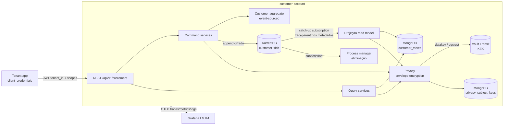
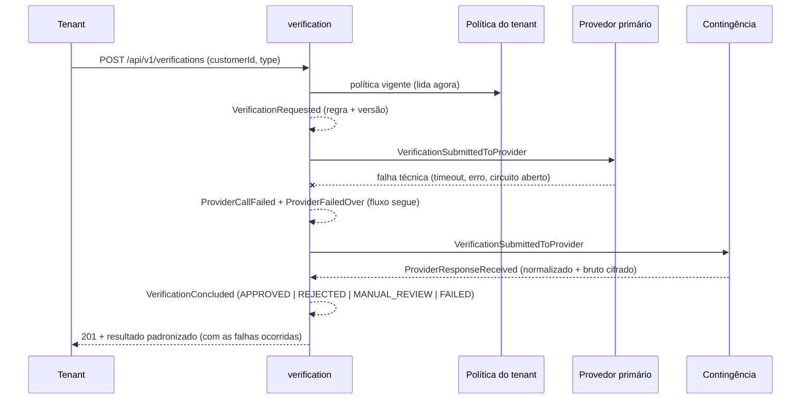
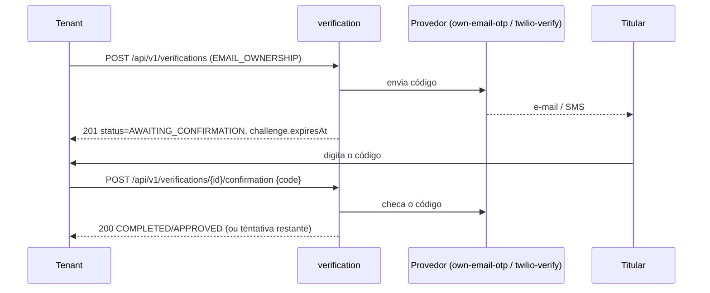

# customer-account

Core **multi-tenant de dados pessoais** compartilhado por várias aplicações (tenants). Java 25 (virtual threads),
Spring Boot 4.1 + Spring Modulith 2.1, **CQRS + Event Sourcing** com **KurrentDB** (escrita) e **MongoDB** (leitura,
via serviço de projeção), segurança e **LGPD by design**, observabilidade com **OpenTelemetry**.

> Status: **Fases 1, 2a e 2b** concluídas (cadastro ES/CQRS; validações com provedor escolhido pelo tenant,
> contingência automática; OTP, Twilio, ZeroBounce, credenciais no Vault e webhook assinado para o tenant).
> Ver [Roadmap](#9-roadmap).

---

## 1. Arquitetura



### Módulos (Spring Modulith — verificados em build por `ModularityTests`)

| Módulo | Responsabilidade | Depende de |
|---|---|---|
| `shared` | Shared kernel: `EventSourcedAggregate`, `TenantId`, exceções, Problem Details | — |
| `platform` | Segurança (resource server, escopos, tenant do token), logging de fluxo, OTel, OpenAPI, `Clock` | shared |
| `eventsourcing` | API neutra `EventStore`/`EventStreamSubscriber` sobre KurrentDB, checkpoints, propagação de trace | shared |
| `privacy` | `PersonalDataCipher` (AES-256-GCM por titular), `BlindIndex` (HMAC), `CryptoShredder` | shared |
| `customer` | Domínio da pessoa, comandos, projeção, consultas, eliminação. API pública: `CustomerDirectory`, `CustomerErasureCompleted` | shared, eventsourcing, privacy |
| `secrets` | `SecretStore` (Vault KV v2 com cache; `local` em dev/teste) para credenciais de provedores | shared |
| `tenant` | Webhook do tenant (URL, segredo HMAC cifrado), fila de entrega com retentativas, proteção SSRF. API pública: `TenantNotifications`, `TenantNotificationDelivered/Failed` | shared, privacy |
| `verification` | Política de provedores por tenant, processo de validação event-sourced (com desafio OTP), gateway resiliente, incidentes, entrega do resultado | shared, eventsourcing, privacy, secrets, customer, tenant |

### Arquitetura limpa dentro de cada módulo de negócio (regras em `HexagonalArchitectureTests`)

```
customer/
  domain/model, domain/event      Java puro (sem Spring/Jackson/Mongo/Kurrent)
  application/port/in|out         casos de uso (ISP) e portas de saída (DIP)
  application/service             orquestração; sem infraestrutura
  application/query               modelo de leitura (CustomerView)
  adapter/in/web                  REST (DTOs + mapper)
  adapter/in/subscription         consumidores do event store (projeção, eliminação)
  adapter/out/eventstore          repositório event-sourced + registro de CPF
  adapter/out/readmodel           MongoDB (perfil cifrado + blind indexes)
  adapter/codec                   eventos de domínio ⇄ payloads versionados (v1) + cifra
```

### Fluxo CQRS / Event Sourcing

1. `POST /customers` → valida value objects → `Customer.register(...)` gera `CustomerRegistered` + `CustomerLinkedToTenant`.
2. **Unicidade de CPF**: reserva atômica no stream `customer_cpf-<HMAC(cpf)>` (concorrência otimista do KurrentDB).
3. Eventos gravados em `customer-<uuidv7>` com **payload cifrado** pela chave do titular.
4. A subscription `customer-read-model-v1` (catch-up em `$all`, filtro por prefixo, checkpoint no Mongo) atualiza
   `customer_views` de forma **idempotente** (por revisão). Consultas leem **somente** o read model.
5. Comandos de alteração retornam **202** (consistência eventual); a resposta de leitura traz `version`.

> Escala: `app.eventstore.subscriptions-enabled` permite separar instâncias **API** (false) de instâncias
> **projetoras** (true) com o mesmo artefato.

---

## 2. Segurança e LGPD

| Tema | Implementação |
|---|---|
| Autenticação de tenants | OAuth2 client credentials (Keycloak). API é resource server stateless; valida `iss`, assinatura e `aud=customer-account` |
| Autorização | Escopos `customer:read`, `customer:write`, `customer:erase`; actuator exige role `admin` |
| Isolamento multi-tenant | `tenant_id` vem **só do token** (claim fixo por client). Cliente de outro tenant → **404** (não revela existência) |
| Criptografia em repouso | **Envelope encryption**: DEK AES-256-GCM por titular, embrulhada pela KEK no **Vault Transit** (a KEK nunca sai do Vault). AAD = id do titular |
| Direito de eliminação (art. 18, VI) | **Crypto-shredding**: `DELETE` grava `CustomerErased`; o process manager libera o CPF e destrói a DEK → eventos imutáveis, read model e backups ficam ilegíveis |
| Busca sem dado em claro | **Blind index** HMAC-SHA256 (CPF, e-mail, celular) com chave segregada |
| Vazamento em logs/URLs | Value objects mascaram `toString()`; logs sem argumentos; CPF buscado via `POST /search` (nunca na URL); erros não ecoam valores |
| Menor privilégio | Token do Vault só pode `datakey`/`decrypt` da KEK e **ler** `secret/customer-account/*` (`docker/vault/customer-account-policy.hcl`) |
| Trilha de auditoria | Toda leitura de dado pessoal gera log `audit.action=personal-data.read` com tenant e titular |
| Menores de idade | Bloqueados (art. 14 exige consentimento dos responsáveis) |

---

## 3. Observabilidade

- **Logs JSON (ECS)** no console + exportação OTLP (Loki). Cada classe usa o próprio logger; `FlowLoggingAspect`
  registra `flow.step`/`flow.phase`/`flow.durationMs` de todo service/adapter em DEBUG.
- **Rastreamento ponta a ponta**: o `traceparent` W3C é gravado nos metadados do evento; o span da subscription vira
  filho da requisição HTTP → **o mesmo `traceId`** aparece no request, no append, na projeção e na eliminação.
- Header `X-Trace-Id` em toda resposta e `traceId` em todo Problem Detail.
- Métricas/spans de negócio via `@Observed` (`customer.command`, `customer.query`) e `eventstore.append/read`.
- Health: `kurrentdb`, `mongo`, liveness/readiness.

Grafana: http://localhost:3000 → Explore → Loki/Tempo, filtre por `traceId`.

---

## 4. Como rodar

### Stack completa

```bash
docker compose up -d --build
# Build atrás de proxy corporativo: docker build --secret id=maven_settings,src=$HOME/.m2/settings.xml .
```

| Serviço | URL |
|---|---|
| API / Swagger | http://localhost:8080/swagger-ui.html |
| KurrentDB UI | http://localhost:2113 |
| Keycloak | http://localhost:8180 (admin/admin) |
| Vault UI | http://localhost:8200 |
| Mailpit (e-mails de OTP) | http://localhost:8025 |
| Grafana | http://localhost:3000 |

Variáveis úteis (`.env`): `KEYCLOAK_PORT` (porta em uso por outro projeto), `KEYCLOAK_IMAGE=keycloak/keycloak`
(quay bloqueado), `KURRENTDB_IMAGE`, `MONGO_PASSWORD`, `PRIVACY_BLIND_INDEX_KEY`.

Requisições prontas em [http/api.http](http/api.http) (tokens de `tenant-app-a`, `tenant-app-b`).

### Desenvolvimento local (app na IDE, infra no Docker)

```bash
docker compose up -d mongodb kurrentdb keycloak mailpit lgtm
mvn spring-boot:run -Dspring-boot.run.profiles=local   # KEK local e segredos locais (sem Vault)
```

### Build e testes

```bash
mvn spotless:apply
mvn verify    # unit + ArchUnit + Modulith verify + integração (Testcontainers: KurrentDB + MongoDB + Mailpit) + JaCoCo + Spotless
```

`CustomerFlowIntegrationTests` cobre: cadastro → projeção → consulta, isolamento de tenant, CPF duplicado, escopos,
ausência de PII em claro no Mongo e no KurrentDB, eliminação com destruição da chave e reuso do CPF.
`VerificationFlowIntegrationTests` cobre política por tenant e contingência; `OtpAndWebhookIntegrationTests` cobre
OTP por e-mail (código lido do Mailpit), webhook assinado com retentativa e registro da entrega.

---

## 5. Dados pessoais

**Implementado (fase 1)**: nome completo, nome social (Decreto 8.727/2016), CPF, data de nascimento, nome da mãe,
estado civil, nacionalidade, e-mail, celular (E.164) e endereço.

**Sugeridos** (cada um com finalidade/base legal definida antes de coletar — princípio da necessidade, art. 6º, III):

| Dado | Uso típico | Observação LGPD |
|---|---|---|
| Documento de identidade (RG/CNH) número, órgão, UF | KYC | Pessoal comum |
| Profissão / faixa de renda | Crédito, suitability | Coletar só se o tenant precisar |
| PEP (pessoa politicamente exposta) | PLD/FT | Vem de provedor; base legal: obrigação regulatória |
| Preferências de contato / opt-in de marketing | Comunicação | Consentimento específico e revogável |
| Status e evidências de verificação (e-mail, celular, identidade) | Antifraude | Guardar **resultado + id da transação do provedor**, nunca a selfie |
| Consentimentos (finalidade, versão da política, data, canal) | Accountability (art. 8º/37) | Módulo `consent` (fase 4) |

**Não armazenar**: biometria (selfie/template facial), dados de saúde, religião, etnia, opinião política — dados
**sensíveis** (art. 5º, II). A validação biométrica fica no provedor; guardamos apenas o veredito.

---

## 6. Autenticação do titular: passwordless + 2 fatores

Não armazenamos senhas. Proposta (fase 4, no Keycloak 26 já provisionado):

1. **Fator 1 – posse**: passkey (WebAuthn/FIDO2, resident key + user verification), com fallback **OTP por e-mail
   ou SMS/WhatsApp** (link mágico/código de uso único).
2. **Fator 2 – inerência/conhecimento**: a própria passkey já é 2FA (dispositivo + biometria/PIN local). Para o
   fallback OTP, segundo fator TOTP ou **step-up biométrico** (liveness no provedor) em operações sensíveis.
3. Tenants autenticam o usuário via **OIDC Authorization Code + PKCE** no realm central (SSO entre tenants), com
   `acr`/`amr` no token para exigir nível de garantia por operação.

O realm já vem com políticas de WebAuthn passwordless e TOTP configuradas; os fluxos de autenticação serão
versionados na fase 4.

---

## 7. Validação de dados e antifraude (fases 2–3)

Todas as integrações entram como **portas** com um adapter por provedor (camada anticorrupção que normaliza o
retorno), **Resilience4j** (retry, circuit breaker, timeout, bulkhead) e **seleção do provedor pelo tenant**.

### 7.1 Provedor configurável por tenant

Cada tenant define, **por tipo de validação**, qual empresa será usada. A configuração é o agregado event-sourced
`TenantVerificationPolicy` (stream `verification_policy-<tenantId>`); cada alteração é o evento
`VerificationRuleConfigured` com a regra anterior, a nova, quem alterou, quando e o motivo (obrigatório).

| Campo da regra | Exemplo |
|---|---|
| Tipo de validação | `FACE_MATCH`, `LIVENESS`, `DOCUMENT`, `FRAUD_SCORE`, `EMAIL_OWNERSHIP`, `EMAIL_QUALITY`, `MOBILE_PHONE_OWNERSHIP`, `MOBILE_PHONE_RISK` |
| Provedor primário | `own-email-otp`, `twilio-verify`, `twilio-lookup`, `zerobounce` (fase 2b); `legitimuz`, `netrin` (fase 3a) |
| Provedor de contingência (opcional, recomendado) | Assume automaticamente em qualquer falha técnica do primário |
| Score mínimo | Abaixo dele o resultado vira `REJECTED` (`SCORE_BELOW_THRESHOLD`) |
| Ação para inconclusivo | `REJECT` ou `MANUAL_REVIEW` |
| Ativo | Liga/desliga a validação para o tenant |

API de administração (role `tenant-admin` do console do próprio tenant):

| Método | Caminho |
|---|---|
| `GET` | `/api/v1/tenant/verification-policy` |
| `PUT` | `/api/v1/tenant/verification-policy/rules/{type}` |
| `GET` | `/api/v1/tenant/verification-policy/history` |
| `GET` | `/api/v1/tenant/verification-providers` |
| `GET` | `/api/v1/tenant/verification-incidents?limit=50` |

- **Vigência na próxima chamada**: a política é lida do event store **a cada validação** (sem cache). Validações em
  andamento terminam com a regra com que começaram (cópia da regra + versão da política em `VerificationRequested`).
- Só aceita provedores registrados na plataforma e que suportam o tipo.
- Segurança do admin: cada tenant tem um client de console (`tenant-<x>-admin`) com a role de client `tenant-admin`;
  o backend só considera roles do client que emitiu o token (`azp`) — admin de um tenant não administra outro.

### 7.2 Processo de validação registrado em eventos

Cada validação é o agregado `VerificationProcess` (stream `verification-<id>`):



| Evento | Conteúdo |
|---|---|
| `VerificationRequested` | tenant, cliente, cópia da regra, versão da política, solicitante |
| `VerificationSubmittedToProvider` | provedor, tentativa |
| `ProviderCallFailed` | provedor, código do erro (`TIMEOUT`, `CIRCUIT_OPEN`, `HTTP_5xx`, `PROVIDER_ERROR`), latência |
| `ProviderFailedOver` | de qual provedor para qual |
| `ProviderResponseReceived` | decisão, score, motivos, id da transação, latência, **resposta bruta** — cifrado com a chave do titular |
| `VerificationConcluded` | resultado padronizado após aplicar a regra do tenant (`APPROVED`, `REJECTED`, `MANUAL_REVIEW`, `FAILED`, `EXPIRED`) — cifrado |
| `ChallengeIssued` | desafio enviado ao titular (OTP): provedor, id da transação, expiração |
| `ChallengeAnswerRejected` | código incorreto (número da tentativa; máx. 5) |
| `VerificationResultDelivered` / `VerificationDeliveryFailed` | entrega do resultado ao webhook do tenant (status HTTP, tentativas) |

Decisões aplicadas:

- **Credenciais por empresa**: cada provedor tem sua própria credencial no Vault KV
  (`secret/customer-account/providers/<provedor>/default`); um tenant com contrato próprio pode ter
  `.../providers/<provedor>/tenants/<tenantId>`, que tem precedência. Credencial ausente = falha técnica
  `CREDENTIALS_NOT_CONFIGURED` → contingência.
- **Resultado padronizado**: o tenant recebe sempre o mesmo formato (`outcome`, `score`, `reasonCodes`,
  `providerTransactionId`, `failover`). A resposta bruta fica só no evento cifrado (auditoria).
- **Contingência automática**: falha técnica do primário → segue para a contingência sem interromper o fluxo; a
  falha aparece no resultado (`failover.occurred/failures`) e no registro de incidentes do tenant
  (`continuedWith`). `FAILED` só ocorre se nenhum provedor configurado responder.
- Resiliência por provedor: retry + circuit breaker (`resilience4j.*.configs.providers`); circuito aberto falha
  rápido e aciona a contingência imediatamente.
- **Selfie/imagem nunca é persistida**. Eliminação do titular destrói a chave (eventos ilegíveis) e remove os
  resultados do read model (`CustomerErasureCompleted`).
- Provedores de sandbox (`simulated-approve`, `simulated-reject`, `simulated-inconclusive`,
  `simulated-unavailable`) para dev/teste: `app.verification.simulated-providers-enabled`.

### 7.3 Provedores

| Necessidade | Provedores escolhidos | Papel sugerido |
|---|---|---|
| Dados pessoais, documento, biometria e antifraude | **Legitimuz**, **Netrin** (fluxo hospedado por link, fase 3a) | Uma primária e a outra como contingência, escolhidas pelo tenant |
| Posse de e-mail | OTP próprio | Código com expiração, hash no armazenamento, rate limit |
| Qualidade do e-mail | **ZeroBounce** | Descartáveis, inexistentes, catch-all |
| Posse e risco do celular | **Twilio Verify + Lookup** | OTP SMS/WhatsApp, tipo de linha, **SIM swap** |

### 7.4 Validações de posse (OTP) — fase 2b



| Provedor | Tipo | Credenciais no Vault (`providers/<id>/default`) | Habilitar |
|---|---|---|---|
| `own-email-otp` | `EMAIL_OWNERSHIP` | — (SMTP do `spring.mail.*`) | `VERIFICATION_OWN_EMAIL_OTP_ENABLED` (padrão `true`) |
| `twilio-verify` | `MOBILE_PHONE_OWNERSHIP` | `account_sid`, `auth_token`, `service_sid` | `VERIFICATION_TWILIO_VERIFY_ENABLED=true` |
| `twilio-lookup` | `MOBILE_PHONE_RISK` | `account_sid`, `auth_token` | `VERIFICATION_TWILIO_LOOKUP_ENABLED=true` |
| `zerobounce` | `EMAIL_QUALITY` | `api_key` | `VERIFICATION_ZEROBOUNCE_ENABLED=true` |

```bash
# Exemplo (stack do compose): root token em docker volume vault-init-state (init.txt)
vault kv put secret/customer-account/providers/zerobounce/default api_key=...
vault kv put secret/customer-account/providers/twilio-verify/tenants/tenant-app-a account_sid=... auth_token=... service_sid=...
```

- OTP próprio: 6 dígitos (`SecureRandom`), guardado só como HMAC, comparação em tempo constante, TTL de 10 min,
  **5 tentativas** (controladas no agregado). Desafio não respondido vira `EXPIRED` (agendador a cada 30s).
- Falha técnica ao checar o código **não** troca de provedor (o desafio pertence a ele): a falha é registrada e a
  API responde `PROVIDER_TEMPORARILY_UNAVAILABLE` para nova tentativa. A checagem não faz retry automático (não
  consome tentativas do titular no provedor).

### 7.5 Entrega do resultado por webhook (módulo `tenant`)

O tenant cadastra a URL (role `tenant-admin`); toda validação concluída gera `verification.completed`.

| Método | Caminho | Observação |
|---|---|---|
| `PUT` | `/api/v1/tenant/webhook` | `{url, rotateSecret?}`; o segredo `whsec_...` aparece **só** quando gerado/rotacionado |
| `GET` | `/api/v1/tenant/webhook` | configuração (sem segredo) |
| `DELETE` | `/api/v1/tenant/webhook` | desativa |
| `GET` | `/api/v1/tenant/webhook/deliveries?limit=20` | status, tentativas, último erro |

Contrato da entrega (`POST` na URL do tenant):

| Header | Valor |
|---|---|
| `X-CA-Event-Id` | `verification.completed:<verificationId>` (determinístico → use para deduplicar) |
| `X-CA-Event-Type` | `verification.completed` |
| `X-CA-Timestamp` | epoch em segundos |
| `X-CA-Signature` | `v1=hex(HMAC-SHA256(segredo, timestamp + "." + corpo))` |

O tenant deve recalcular a assinatura, comparar em tempo constante e rejeitar timestamps com mais de 5 min. Corpo:
`{eventId, eventType, occurredAt, data: {verificationId, customerId, type, outcome, provider, score, reasonCodes,
providerTransactionId, policyVersion, failover, requestedAt, concludedAt}}` — sem dados pessoais.

- Qualquer resposta fora de 2xx → retentativas em 30s, 2m, 10m, 30m, 1h, 3h, 6h (8 tentativas); o desfecho vira
  `VerificationResultDelivered`/`VerificationDeliveryFailed` no processo e aparece em `delivery` na API.
- Fila no MongoDB com lease (várias instâncias sem entrega duplicada), payload cifrado com a chave do titular
  (eliminado antes da entrega → descartado) e removido após a entrega; registros expiram em 30 dias.
- **SSRF**: exige `https`, sem credenciais na URL, bloqueia loopback/redes privadas/link-local (metadados de nuvem)/
  CGNAT, não segue redirects; checado ao cadastrar e a cada envio. Limitação: DNS rebinding entre checagem e conexão
  — em produção use também proxy de saída com allowlist.
- **MFA do admin**: `app.security.tenant-admin-acr-values` (produção: `2`) exige `acr` do segundo fator no token
  para `/api/v1/tenant/**`. O fluxo step-up no Keycloak é versionado na fase 4.

---

## 8. Configuração

| Propriedade | Descrição |
|---|---|
| `app.eventstore.connection-string` | `kurrentdb://...` (produção: TLS + credenciais) |
| `app.eventstore.subscriptions-enabled` | Liga/desliga projeções nesta instância |
| `app.privacy.key-provider` | `vault` (padrão) ou `local` (somente dev/teste) |
| `app.privacy.blind-index-key` | Chave HMAC base64 ≥ 32 bytes (secret manager) |
| `app.privacy.vault.*` | `uri`, `token` ou `token-file`, `transit-mount`, `key-name`, `timeout` |
| `app.privacy.data-key-cache-ttl` | TTL do cache de DEKs em memória (trade-off latência × janela pós-shredding) |
| `app.verification.simulated-providers-enabled` | Provedores de sandbox (`true` em local/docker/test; **sempre `false` em produção**) |
| `app.verification.providers.*` | Liga/desliga e URL/timeout de `own-email-otp`, `twilio-verify`, `twilio-lookup`, `zerobounce` |
| `app.verification.expiration-check-interval` | Frequência de expiração de desafios OTP (padrão 30s) |
| `app.secrets.*` | `provider` (`vault`/`local`), `cache-ttl`, `vault.{uri,token,token-file,kv-mount,base-path}` |
| `app.tenant.webhook.*` | `allow-insecure-targets`/`allow-private-targets` (**só dev**), `timeout`, `max-attempts`, `batch-size`, `dispatch-interval` |
| `app.security.tenant-admin-acr-values` | `acr` exigido para administração do tenant (produção: `2`) |
| `spring.mail.*` | SMTP do OTP próprio (`MAIL_HOST`, `MAIL_PORT`, `SPRING_MAIL_USERNAME/PASSWORD`); `OTP_MAIL_FROM` |
| `resilience4j.{retry,circuitbreaker}.configs.providers` | Retry e circuit breaker aplicados a cada provedor (`provider-<id>`) |

---

## 9. Roadmap

| Fase | Entregas |
|---|---|
| **1 (feito)** | Módulos base, Customer ES/CQRS, projeção Mongo, crypto-shredding, Vault, Keycloak (tenants), OTel, compose, testes |
| **2a (feito)** | Módulo `verification`: `TenantVerificationPolicy` + API de administração com histórico (role `tenant-admin` por console de tenant), `VerificationProcess` com todos os eventos, gateway com retry/circuit breaker por provedor, **contingência automática com registro da falha** (resultado + incidentes do tenant), resultado padronizado, read model e eliminação, provedores de sandbox |
| **2b (feito)** | Módulo `secrets` (Vault KV, credencial por provedor e por tenant); OTP próprio por e-mail, Twilio Verify/Lookup, ZeroBounce; desafio com `AWAITING_CONFIRMATION`, 5 tentativas e expiração; módulo `tenant` com webhook assinado (HMAC), fila com retentativas, proteção SSRF e `VerificationResultDelivered`; `acr` exigido para admins (produção); Mailpit no compose |
| 3a – Validação hospedada | Link de validação (Legitimuz/Netrin genéricos), webhook de entrada, regras do tenant, validade/revalidação — [spec](spec/fase-3a-validacao-hospedada.md) |
| 3b – Canal de status | Token de canal, polling público, push SignalR/SSE — [spec](spec/fase-3b-canal-tempo-real.md) |
| 4a – Autenticação | Passwordless + 2FA do titular, MFA/step-up dos admins — [spec](spec/fase-4a-autenticacao-titular-admin.md) |
| 4b – Consentimento | Módulo `consent`, vínculo entre tenants com aceite do titular, minimização — [spec](spec/fase-4b-consentimento.md) |
| 5 – Integração | Kafka no compose, eventos para tenants, portal do titular (art. 18) — [spec](spec/fase-5-integracao-kafka-portal.md) |
| Transversal | Idempotência, rate limit, parking, snapshots, upcasters, rotação de KEK, auditoria imutável — [spec](spec/fase-t-transversal.md) |

Escopo de integrações reduzido a **Legitimuz e Netrin** (decisões em [spec/README.md](spec/README.md)).

---

## 10. Decisões em aberto (validar com o tech lead/DPO)

1. **Retenção x eliminação**: obrigações legais (ex.: PLD, 5 anos) podem exigir reter parte dos dados após o pedido de
   eliminação — definir quais e por quanto tempo (crypto-shredding pode ser agendado).
2. **Eliminação global x por tenant**: hoje o `DELETE` elimina o titular para todos; revogação por tenant virá com o
   módulo de consentimento.
3. **Celular estrangeiro e endereço fora do Brasil**: hoje só BR.
4. **Key store em cluster separado** do read model (recomendado em produção) e política de backup alinhada ao shredding.
