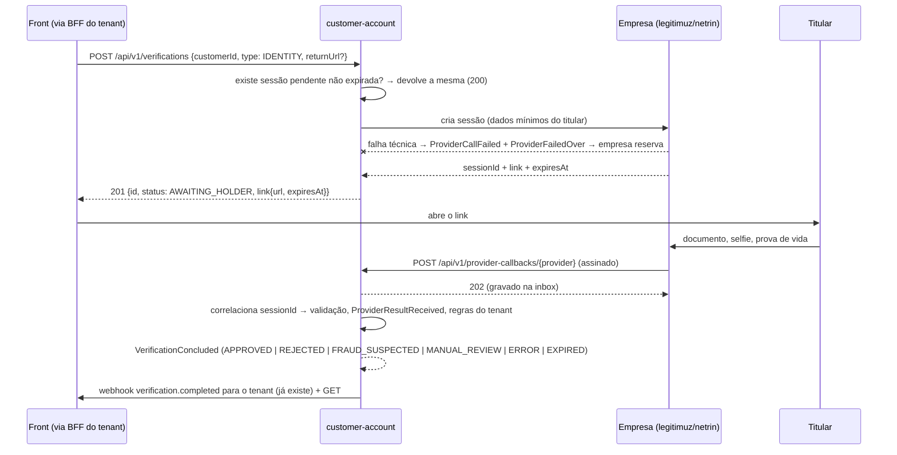

# Fase 3a — Validação hospedada (link) com Legitimuz e Netrin genéricos

> Pré-leitura: [00-contexto-atual.md](00-contexto-atual.md). Independente das demais fases.

## 1. Objetivo

O tenant (frontend via BFF) pede uma validação de identidade; o backend escolhe a empresa pela política do tenant,
cria a sessão na empresa e **devolve o link**. O titular conclui no site da empresa; a empresa envia o **resultado por
webhook**; o backend registra a recepção como evento, aplica as **regras do tenant** (sucesso, fraude, erro) e
publica o desfecho. O titular pode **revalidar** várias vezes; aprovação tem **prazo de validade**.

## 2. Escopo

Dentro: tipo `IDENTITY`; porta genérica de provedor hospedado; adapters **genéricos configuráveis** `legitimuz` e
`netrin` (sem contrato real); sandbox `simulated-hosted`; endpoint de webhook de entrada; inbox de callbacks;
classificação por regras do tenant; reuso do link pendente; contingência; expiração; validade e status atual por
cliente; testes.

Fora: canal em tempo real e polling público (fase 3b); integração real com Legitimuz/Netrin (aguarda documentação);
Serpro/Unico/Serasa (removidos do escopo).

## 3. Fluxo



## 4. Domínio (`verification.domain`)

### 4.1 Tipos e estados

- `VerificationType.IDENTITY` (documento + face + prova de vida no provedor).
- `VerificationStatus.AWAITING_HOLDER` (link emitido, aguardando o titular).
- `VerificationOutcome` + `FRAUD_SUSPECTED`, `ERROR`.
- Value object `HostedResult(sessionId, status, score, reasonCodes, fraudSignals, providerEventId, occurredAt, raw)`
  com `HostedResultStatus` = `COMPLETED | USER_FAILED | FRAUD_DETECTED | PROVIDER_ERROR | ABANDONED`
  (status normalizado; cada adapter mapeia os status da empresa para este conjunto).

### 4.2 Regras do tenant (D6, D7) — extensão de `VerificationRule`

Novo record opcional `HostedResultRules` dentro da regra (obrigatório quando `type = IDENTITY`):

| Campo | Uso | Padrão |
|---|---|---|
| `minimumScore` (já existe na regra) | score abaixo → `scoreBelowAction` | — |
| `scoreBelowAction` | `REJECT` ou `MANUAL_REVIEW` | `REJECT` |
| `fraudReasonCodes` | motivos normalizados que classificam como fraude | `[]` |
| `manualReviewReasonCodes` | motivos que forçam revisão manual | `[]` |
| `onProviderError` | `ERROR` ou `MANUAL_REVIEW` | `ERROR` |
| `validityDays` | prazo de validade da aprovação (1–3650) | `365` |
| `allowedReturnUrlPrefixes` | prefixos permitidos para `returnUrl` (evita open redirect) | `[]` |

Classificação (ordem de precedência), implementada em `HostedResultClassifier` (domínio puro):

1. `FRAUD_DETECTED` ou qualquer `reasonCode`/`fraudSignal` ∈ `fraudReasonCodes` → `FRAUD_SUSPECTED`
2. `PROVIDER_ERROR` → `onProviderError`
3. `ABANDONED` → `EXPIRED`
4. `USER_FAILED` → `MANUAL_REVIEW` se algum motivo ∈ `manualReviewReasonCodes`, senão `REJECTED`
5. `COMPLETED` → score < mínimo ⇒ `scoreBelowAction`; motivo ∈ `manualReviewReasonCodes` ⇒ `MANUAL_REVIEW`;
   senão `APPROVED` com `validUntil = concludedAt + validityDays`

As regras aplicadas são as **copiadas no `VerificationRequested`** (vigentes no pedido) — coerente com a fase 2a.
O `VerificationRuleConfigured` ganha payload `v2`; o codec lê `v1` com os padrões acima (upcast).

### 4.3 Novos eventos em `VerificationProcess`

| Evento | Conteúdo | Cifrado |
|---|---|---|
| `VerificationLinkIssued` | provider, sessionId, linkUrl, expiresAt, sharedFields (campos enviados ao provedor) | sim (link é credencial) |
| `ProviderResultReceived` | provider, providerEventId, `HostedResult` normalizado + bruto | sim |
| `LateProviderResultIgnored` | provider, providerEventId, motivo (`ALREADY_CONCLUDED`) | não |
| `VerificationConcluded` | + `validUntil` (nulo se não aprovado) | sim (já é) |
| `VerificationValidityExpired` | validUntil | não |

Métodos novos: `linkIssued(session, clock)`, `resultReceived(hostedResult, clock)`, `expireIfDue(clock)` (estender
para `AWAITING_HOLDER` usando o `expiresAt` do link + tolerância de 15 min para callbacks atrasados),
`validityExpired(clock)`. Callback de validação já concluída → `LateProviderResultIgnored` (não muda o desfecho).

## 5. Aplicação (`verification.application`)

- `RequestVerificationUseCase.request(...)` passa a aceitar `returnUrl` opcional; para `IDENTITY` usa o fluxo hospedado.
- **Reuso (D5)**: porta `ActiveSessionRegistryPort` com `findActive(tenant, customerId, type, now)` e
  `claim(tenant, customerId, type, verificationId, expiresAt)` atômico (índice único). Pendente e não expirado →
  devolve a view existente (`reused = true`, HTTP 200). Ao concluir/expirar → `release`.
- Porta `HostedVerificationGateway.start(provider, request) → HostedSession(sessionId, url, expiresAt, raw)` com
  retry + circuit breaker + observação (mesmo padrão do `ResilientProviderGateway`) e falha → contingência (D4).
- `ReceiveProviderResultUseCase.receive(providerId, HostedResult)` — correlação via
  `SessionCorrelationPort.find(provider, sessionId) → verificationId` (gravado **sincronamente** ao emitir o link).
- `CustomerVerificationStatusQuery`: status atual por (tenant, cliente, tipo): `NONE | PENDING | VALID |
  EXPIRED | NOT_APPROVED`, `validUntil`, última validação.
- Agendadores: expiração de links (`AWAITING_HOLDER`) e de validade (`VALID` com `validUntil` vencido) → eventos.

## 6. Adapters

### 6.1 Provedor hospedado genérico (`adapter/out/provider/hosted`)

Interface `HostedVerificationProvider`:

```java
ProviderId id();
Set<VerificationType> supportedTypes();          // IDENTITY
HostedSession start(ProviderRequest request, Optional<URI> returnUrl);
CallbackAuthentication authenticate(Map<String, List<String>> headers, byte[] body); // assinatura/token
List<HostedResult> parse(Map<String, List<String>> headers, byte[] body);
default Optional<HostedResult> fetch(String sessionId) { return Optional.empty(); } // polling opcional
```

`GenericHostedProvider` (uma instância por empresa, **toda a especificidade em configuração**):

```yaml
app.verification.hosted-providers:
  legitimuz:            # idem para netrin
    enabled: false
    base-url: https://api.exemplo-legitimuz.invalid
    timeout: 5s
    auth: { scheme: BEARER }            # BEARER | BASIC | API_KEY_HEADER (+ header-name); valores no Vault
    create-session:
      method: POST
      path: /v1/sessions
      body-template: classpath:hosted/legitimuz-create.json   # placeholders {{cpf}}, {{name}}, {{returnUrl}}, {{reference}}
      response: { session-id: $.id, url: $.url, expires-at: $.expiresAt }
    callback:
      auth: { scheme: HMAC_SHA256, signature-header: X-Signature, timestamp-header: X-Timestamp, tolerance: 5m }
      event-id: $.eventId
      session-id: $.sessionId
      status: $.status
      score: $.score
      reason-codes: $.reasons[*]
      fraud-signals: $.fraudSignals[*]
      status-map: { approved: COMPLETED, denied: USER_FAILED, fraud: FRAUD_DETECTED, error: PROVIDER_ERROR, expired: ABANDONED }
      reason-map: {}                      # código da empresa → código normalizado
    allowed-source-cidrs: []              # opcional: allowlist de IPs da empresa
```

Credenciais no Vault: `providers/<id>/default` (ou `/tenants/<tenant>`) com `api_token` (ou `client_id`/`client_secret`)
e `webhook_secret`. JSONPath via `com.jayway.jsonpath` (já no classpath de teste; adicionar como dependência de compile).

### 6.2 Sandbox `simulated-hosted` (perfis local/docker/test)

- `start` devolve `http(s)://<app>/dev/hosted-verification/{sessionId}` (página HTML simples com botões
  Aprovar / Reprovar / Fraude / Erro / Abandonar).
- Cada botão envia um callback **assinado** para `/api/v1/provider-callbacks/simulated-hosted` (mesmo caminho real).
- Controller de dev só registrado com `app.verification.simulated-providers-enabled=true`.

### 6.3 Webhook de entrada (`adapter/in/web/ProviderCallbackController`)

- `POST /api/v1/provider-callbacks/{providerId}` — **público** no `SecurityConfig` (sem JWT), autenticado pela
  assinatura do provedor. Limite de corpo 256 KB; `Content-Type` JSON.
- Provedor desconhecido/desabilitado → 404; assinatura inválida, timestamp fora da tolerância ou IP fora da
  allowlist → 401 (log `security.event=provider-callback-rejected`, métrica), sem detalhes na resposta.
- Válido → grava na **inbox** `verification_callback_inbox` (payload cifrado com subject
  `provider-callback:<provider>`, dedupe por `provider + providerEventId` ou SHA-256 do corpo, TTL 7 dias) e
  responde **202** imediatamente (o provedor não espera o processamento).
- Processador (`adapter/in/scheduler/CallbackInboxProcessor`): claim com lease (mesmo padrão de
  `MongoNotificationQueue`) → `parse` → `ReceiveProviderResultUseCase`. Estados: `PROCESSED`, `UNMATCHED`
  (sessão desconhecida → incidente), `INVALID` (parse falhou → incidente), retentativa com backoff para falhas
  transitórias. Payload removido após processar.

### 6.4 Persistência e leitura

- `verification_active_sessions` (índice único `tenant+customer+type`, TTL em `expiresAt + 1d`).
- `verification_session_index` (`provider+sessionId` → `verificationId`, `tenantId`).
- `verification_views`: + `link` (url **cifrada**, expiresAt), `validUntil`, `reused`.
- `customer_verification_status` (projeção `verification-status-v1`).
- Eliminação do titular (`CustomerErasureCompleted`) remove as três coleções do cliente.

### 6.5 API (tenant, escopos existentes)

| Método | Caminho | Resposta |
|---|---|---|
| `POST` | `/api/v1/verifications` `{customerId, type: IDENTITY, returnUrl?}` | 201 nova / 200 reuso: `{id, status, link{url, expiresAt}, ...}` |
| `GET` | `/api/v1/verifications/{id}` | inclui `link` enquanto `AWAITING_HOLDER`, `validUntil` |
| `GET` | `/api/v1/customers/{customerId}/verification-status` | status atual por tipo |
| `GET` | `/api/v1/verifications?customerId=` | histórico (revalidações) |

Webhook ao tenant `verification.completed` ganha `validUntil` e os novos outcomes; novo evento
`verification.validity_expired`.

## 7. Segurança e LGPD

- Link é **credencial do titular**: cifrado em eventos/read model, nunca logado, só devolvido ao tenant dono.
- `returnUrl` validado contra `allowedReturnUrlPrefixes` (https obrigatório).
- Dados enviados à empresa: mínimo configurável por provedor (`shared-fields`); registrar em `sharedFields` do
  evento (accountability, art. 37). A empresa é **operadora** — contrato/DPA é pendência do negócio.
- Callback: assinatura HMAC com timestamp (anti-replay) + dedupe + allowlist opcional + limite de tamanho.
- Imagens/biometria **nunca** trafegam por nós; só o veredito e códigos.

## 8. Configuração nova

`app.verification.hosted-providers.*` (seção 6.1), `app.verification.callback-inbox.{batch-size,interval,lease}`,
`app.verification.validity-check-interval` (padrão 1h), `app.verification.link-grace-period` (15m).
Compose: nada novo (sandbox roda na própria app).

## 9. Tarefas

- [ ] T1 Domínio: tipo/estado/outcomes, `HostedResult`, `HostedResultRules`, `HostedResultClassifier`, eventos e métodos do `VerificationProcess`, testes unitários (classificação: uma regra por caso).
- [ ] T2 Política: `HostedResultRules` na regra, DTOs admin, codec `v2` + upcast `v1`, validações (IDENTITY exige regras).
- [ ] T3 Aplicação: fluxo hospedado no `VerificationService`, `ActiveSessionRegistryPort`, `SessionCorrelationPort`, `ReceiveProviderResultUseCase`, status por cliente, agendadores.
- [ ] T4 Gateway hospedado resiliente + contingência; `GenericHostedProvider` + properties; registrar `legitimuz` e `netrin` (desabilitados).
- [ ] T5 Sandbox `simulated-hosted` + página de dev.
- [ ] T6 Webhook de entrada + inbox + processador + `SecurityConfig` (rota pública).
- [ ] T7 Codec dos novos eventos, read models, projeção `verification-status-v1`, eliminação.
- [ ] T8 API web (DTOs, mapper, endpoint de status), webhook ao tenant atualizado, `http/api.http`.
- [ ] T9 ITs: (a) link → callback aprovado → `APPROVED` + `validUntil`; (b) reuso do link pendente; (c) primário fora → reserva + incidente; (d) callback com fraude → `FRAUD_SUSPECTED`; (e) assinatura inválida → 401 e nada gravado; (f) callback duplicado idempotente; (g) callback após conclusão → `LateProviderResultIgnored`; (h) link expirado → `EXPIRED`; (i) isolamento entre tenants; (j) eliminação limpa tudo.
- [ ] T10 README (seção 7), `spec/README.md` (status).

## 10. Adapter real (quando chegar a documentação de cada empresa)

1. Preencher a configuração 6.1 (paths, autenticação, JSONPaths, `status-map`, `reason-map`) — idealmente sem código.
2. Se o formato fugir do genérico, criar `LegitimuzProvider`/`NetrinProvider` implementando `HostedVerificationProvider`.
3. Teste de contrato com payloads reais anonimizados em `src/test/resources/hosted/<empresa>/`.
4. Cadastrar credenciais e `webhook_secret` no Vault; cadastrar a URL de callback no painel da empresa.

## 11. Pronto quando

`mvn clean verify` verde (ArchUnit + Modulith), todos os ITs da T9 passando, fluxo demonstrável no compose com
`simulated-hosted` (pedido → página de dev → callback → resultado) e README atualizado.
